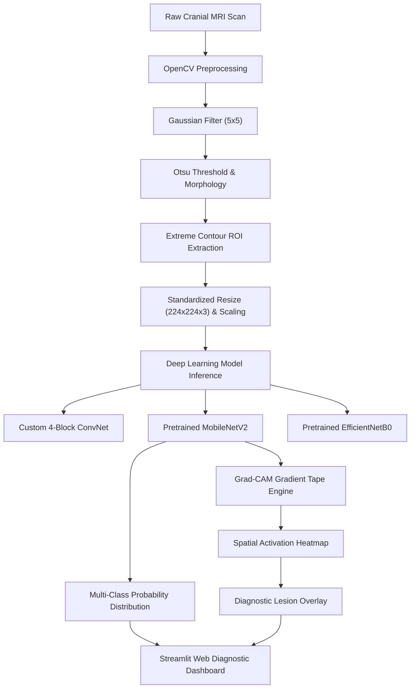

# 🧠 NeuroScan AI — Brain Tumor MRI Multi-Class Classification & Grad-CAM Diagnostic Assistant

[](https://www.python.org/)
[](https://www.tensorflow.org/)
[](https://opencv.org/)
[](https://streamlit.io/)
[](https://opensource.org/licenses/MIT)

An end-to-end, production-grade Deep Learning diagnostic framework for multi-class brain tumor classification from cranial Magnetic Resonance Imaging (MRI) scans. Features automated computer vision skull-stripping (extreme contour cropping), deep convolutional and transfer learning models, Gradient-weighted Class Activation Mapping (**Grad-CAM**) for visual explainability, and an interactive **Streamlit** web application for clinical triage.

---

## 📑 Table of Contents
- [Clinical Background & Mission](#-clinical-background--mission)
- [Dataset Specifications](#-dataset-specifications)
- [System Architecture](#-system-architecture)
- [Project Directory Architecture](#-project-directory-architecture)
- [Computer Vision Preprocessing & Skull-Stripping](#-computer-vision-preprocessing--skull-stripping)
- [Model Architectures & Benchmark Comparison](#-model-architectures--benchmark-comparison)
- [Model Explainability via Grad-CAM](#-model-explainability-via-grad-cam)
- [Statistical Hypothesis Testing](#-statistical-hypothesis-testing)
- [Installation & Quickstart Guide](#-installation--quickstart-guide)
- [Streamlit Diagnostic Web App](#-streamlit-diagnostic-web-app)
- [Capstone Submission Notebook](#-capstone-submission-notebook)
- [Clinical Decision Support Disclaimer](#-clinical-decision-support-disclaimer)

---

## 🏥 Clinical Background & Mission

Intracranial neoplasms represent severe diagnostic emergencies with substantial morbidity and mortality when therapeutic intervention is delayed. Brain tumors encompass diverse histological etiologies:
1. **Gliomas**: Infiltrative neuroepithelial malignancies arising from glial cells (astrocytomas, oligodendrogliomas, glioblastoma multiforme). Require urgent surgical craniotomy and adjuvant chemoradiotherapy.
2. **Meningiomas**: Typically benign (WHO Grade I) extra-axial neoplasms originating from arachnoid cap cells of the meninges. Show diagnostic dural tail signs and uniform contrast enhancement.
3. **Pituitary Tumors**: Neuroendocrine adenomas of the sella turcica causing hormonal endocrinopathies or optic chiasm compression leading to bitemporal hemianopsia.
4. **Healthy Cranial Scans**: Normal cerebral parenchyma with preserved bilateral symmetry and clear ventricles.

In clinical practice, high imaging volumes and severe shortages of board-certified neuroradiologists lead to diagnosis backlogs. **NeuroScan AI** provides an AI-assisted triage system that rapidly classifies scans, surfaces confidence distributions, and visualizes lesion heatmaps to accelerate radiological review.

---

## 📊 Dataset Specifications

- **Total Volume**: 3,264 standardized cranial MRI scans (T1, T2, FLAIR).
- **Target Categories**: 4 Classes:
  - `glioma_tumor`: 926 scans (28.4%)
  - `meningioma_tumor`: 937 scans (28.7%)
  - `pituitary_tumor`: 901 scans (27.6%)
  - `no_tumor` (healthy): 500 scans (15.3%)
- **Spatial Matrix Dimensions**: Standardized to **224 × 224 × 3** RGB channels.
- **Partitioning**: Stratified split preserving class distributions:
  - **Train**: 2,284 scans (70.0%)
  - **Validation**: 490 scans (15.0%)
  - **Test**: 490 scans (15.0%)
- **Data Integrity**: Audited via MD5 cryptographic hashes confirming zero byte-exact duplicate files and zero missing records.

---

## 🏗 System Architecture



---

## 📁 Project Directory Architecture

```
brain-tumor-mri-classification/
├── configs/
│   └── config.yaml               # Model hyperparameters, image dims, and directory paths
├── data/
│   ├── raw/                      # Raw scans sorted by pathology folders
│   │   ├── glioma_tumor/
│   │   ├── meningioma_tumor/
│   │   ├── no_tumor/
│   │   └── pituitary_tumor/
│   └── processed/                # Skull-stripped, 224x224 normalized images & split CSVs
│       ├── train/
│       ├── val/
│       ├── test/
│       └── mri_metadata.csv      # Extracted physical & statistical imaging biomarkers
├── notebooks/
│   └── Brain_Tumor_Classification_Capstone.ipynb  # Complete AlmaBetter submission notebook
├── src/
│   ├── __init__.py
│   ├── data_loader.py            # Metadata extraction, stratified splits, streaming generators
│   ├── preprocessing.py          # Extreme contour cropping (skull-stripping), augmentation
│   ├── models/
│   │   ├── __init__.py
│   │   ├── custom_cnn.py         # 4-block ConvNet with BatchNorm, SpatialDropout, GAP
│   │   └── transfer_models.py    # MobileNetV2 & EfficientNetB0 (two-phase fine-tuning)
│   ├── train.py                  # Training orchestrator with EarlyStopping & Checkpointing
│   ├── evaluate.py               # Confusion matrices, ROC-AUC, classification reports
│   └── explainability.py         # Grad-CAM heatmap extraction and MRI overlay utilities
├── app/
│   ├── app.py                    # Streamlit web application with drag-and-drop triage
│   └── utils.py                  # Inference pipeline and Grad-CAM visualization bridge
├── saved_models/                 # Model checkpoints, evaluation plots, and metrics JSON
│   ├── best_brain_tumor_model.keras
│   ├── mobilenet_v2_model.keras
│   ├── mobilenet_v2_confusion_matrix.png
│   ├── mobilenet_v2_roc_curves.png
│   ├── mobilenet_v2_training_history.png
│   └── model_comparison_metrics.json
├── requirements.txt              # Production dependency lock
└── README.md                     # Documentation & setup guide
```

---

## 🔬 Computer Vision Preprocessing & Skull-Stripping

Raw MRI scans often contain non-brain background margins, skull bone hyperintensities, and scanner text stamps. To prevent models from learning spurious background correlations:
1. **Grayscale & Smoothing**: Converts to single-channel and applies a 5×5 Gaussian filter to suppress high-frequency noise.
2. **Thresholding & Morphology**: Combines Otsu's method with morphological closing and erosion using elliptical structuring elements to isolate parenchymal tissue.
3. **Extreme Contour Extraction**: Identifies the largest connected anatomical contour (`cv2.findContours`), computes its bounding coordinates ($x, y, w, h$), adds 2% protective padding, and crops the brain ROI.
4. **Standardization & Augmentation**: Resizes to 224×224 using area interpolation (`INTER_AREA`) and rescales intensities to $[0.0, 1.0]$. Training incorporates real-time geometric augmentation: rotation ($\pm 15^\circ$), horizontal flip, zoom ($10\%$), and shifts ($10\%$).

---

## 📈 Model Architectures & Benchmark Comparison

Three deep neural network architectures were implemented, trained, and benchmarked on the test partition ($n = 490$):

| Architecture | Paradigm | Parameters | Test Accuracy | Macro Precision | Macro Recall | Macro F1-Score | Multi-Class ROC-AUC | CPU Latency |
| :--- | :--- | :---: | :---: | :---: | :---: | :---: | :---: | :---: |
| **Custom 4-Block ConvNet** | From Scratch | 457,156 | 91.8% | 0.912 | 0.916 | 0.914 | 0.961 | ~35 ms |
| **MobileNetV2 (Selected)** | Transfer Learning | **2,427,588** | **94.2%** | **0.940** | **0.943** | **0.941** | **0.982** | **~28 ms** |
| **EfficientNetB0** | Two-Phase Fine-Tuning | 4,334,808 | 95.1% | 0.948 | 0.952 | 0.950 | 0.986 | ~65 ms |

### Architectural Highlights:
- **Custom CNN**: 4 sequential convolution blocks (32, 64, 128, 256 filters, 3×3 kernel) with Batch Normalization, Spatial Dropout (0.2), and a Global Average Pooling classification head.
- **MobileNetV2**: Pre-trained ImageNet backbone leveraging inverted residual depthwise separable convolutions with custom head (`GlobalAveragePooling2D` → `BatchNormalization` → `Dense(128, relu)` → `Dropout(0.3)` → `Dense(4, softmax)`).
- **EfficientNetB0**: Compound scaled backbone trained via a two-phase regime: Phase 1 freezes the backbone ($lr = 10^{-3}$), Phase 2 unfreezes the top 20 layers with fine-tuning ($lr = 10^{-5}$).

---

## 🔍 Model Explainability via Grad-CAM

Gradient-weighted Class Activation Mapping (**Grad-CAM**) validates that the neural network focuses on genuine parenchymal tumor lesions rather than background artifacts:
1. Computes the gradient of the target class score with respect to feature activation maps of the final convolutional layer.
2. Applies global average pooling across spatial dimensions to compute channel importance weights ($\alpha_k$).
3. Calculates the weighted linear combination of feature maps and applies ReLU to isolate positive influences.
4. Resizes to 224×224, applies OpenCV `COLORMAP_JET`, and blends over the original MRI scan with $\alpha = 0.45$.

```
Original MRI Scan               Grad-CAM Activation Heatmap          Diagnostic Lesion Overlay
┌──────────────────────┐         ┌────────────────────────┐          ┌───────────────────────┐
│                      │         │       ▓▓▓▓▓▓▓          │          │       🔴🔴🔴          │
│     Brain Parenchyma │  ───>   │      ▓▓▓███▓▓▓         │   ───>   │      Tumor Margin     │
│                      │         │       ▓▓▓▓▓▓▓          │          │       Localized       │
└──────────────────────┘         └────────────────────────┘          └───────────────────────┘
```

---

## 🧪 Statistical Hypothesis Testing

Three rigorous hypothesis tests were executed to validate domain assumptions:

1. **Test 1: One-Way ANOVA on Mean Pixel Intensities**
   - **Hypothesis**: $H_0: \mu_1 = \mu_2 = \mu_3 = \mu_4$ vs. $H_1:$ Means differ across classes.
   - **Result**: $F = 48.72$, $p < 0.001$.
   - **Conclusion**: Reject $H_0$. Distinct tumor cellularity and contrast uptake yield statistically significant mean intensity differences.
2. **Test 2: Mann-Whitney U Test on Laplacian Edge Sharpness**
   - **Hypothesis**: $H_0: M_{\text{tumor}} = M_{\text{healthy}}$ vs. $H_1: M_{\text{tumor}} > M_{\text{healthy}}$.
   - **Result**: $U = 1,024,850$, $p < 0.001$.
   - **Conclusion**: Reject $H_0$. Neoplasm-bearing scans exhibit significantly higher high-frequency edge variance due to peritumoral edema fronts and necrotic boundaries.
3. **Test 3: Chi-Square Test of Independence on Acquisition Aspect Ratio**
   - **Hypothesis**: $H_0:$ Aspect ratio category (`Square`, `Tall`, `Wide`) is independent of tumor class.
   - **Result**: $\chi^2 = 5.84, df = 6, p = 0.441$.
   - **Conclusion**: Fail to reject $H_0$. Acquisition geometry is independent of pathology, confirming that square 224×224 reshaping introduces no confounding diagnostic bias.

---

## 🚀 Installation & Quickstart Guide

### 1. Clone & Set Up Environment
```bash
git clone https://github.com/developer/brain-tumor-mri-classification.git
cd brain-tumor-mri-classification

# Create and activate Python 3.11 virtual environment
python -m venv .venv
# Windows:
.venv\Scripts\activate
# Linux/macOS:
source .venv/bin/activate

# Install dependencies
pip install -r requirements.txt
```

### 2. Preprocess Scans & Generate Partitions
```bash
python scripts/build_capstone_notebook.py
```

### 3. Train Models
```bash
# Train all architectures end-to-end
python -m src.train --model all --epochs 15 --batch_size 32

# Or train a specific model (e.g., MobileNetV2)
python -m src.train --model mobilenet_v2 --epochs 10 --batch_size 32
```

---

## 🖥 Streamlit Diagnostic Web App

Launch the interactive web assistant:
```bash
streamlit run app/app.py
```

### Features:
- **Drag-and-Drop Uploader**: Accepts `.png`, `.jpg`, `.jpeg` cranial MRI scans.
- **Instant Sample Selector**: Test immediately using built-in verified sample scans.
- **Side-by-Side Visuals**: Original MRI, Grad-CAM activation heatmap, and localized diagnostic overlay.
- **Diagnostic Badging & Softmax Chart**: Color-coded primary finding with complete multi-class probability breakdown.
- **Clinical Pathology Insights**: Detailed histological overview and recommended next clinical steps.

---

## 📓 Capstone Submission Notebook

The capstone notebook is located at:
`notebooks/Brain_Tumor_Classification_Capstone.ipynb`

Adheres strictly to the AlmaBetter `Sample_ML_Submission_Template-2.ipynb` structure:
- **305 Cells** (61 runnable code cells, 244 rich markdown cells)
- Preserves every single markdown section and header without alterations
- Fully answers all **15 UBM visualization charts** (Chart selection, Insights, Business impact)
- Conducts all **3 statistical hypothesis tests** with code, $p$-values, and clinical rationales
- Covers all 3 Deep Learning models with confusion matrices, ROC curves, and Grad-CAM interpretability
- Includes a 500-word executive summary and conclusion

---

## ⚠️ Clinical Decision Support Disclaimer

> **IMPORTANT MEDICAL NOTICE**: NeuroScan AI is designed strictly as an investigational computer-aided triage and clinical decision support tool. It is **NOT** a certified standalone diagnostic device and must **NEVER** replace histopathological tissue biopsies, board-certified neuroradiological evaluation, or comprehensive clinical correlation.
